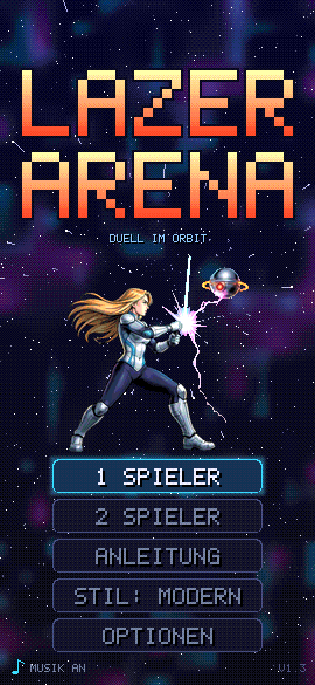
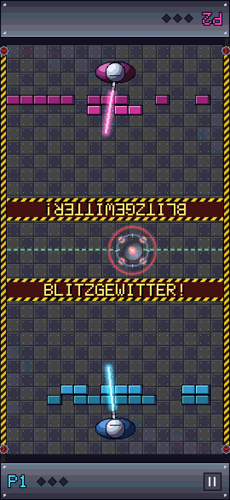
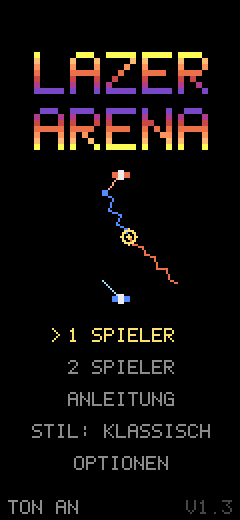
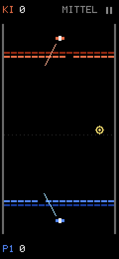

# Lazer Arena

*Duel in orbit – an Android game in C# and MonoGame.* · [Deutsch](#deutsch)

A drone floats between two fighters and fires lightning bolts at them. Each fighter turns a light sword to catch the bolts at its tip and aims the drone's shots at the opponent. Shields break, storms rage, and the first to score 3 hits wins.

Lazer Arena is an original game inspired by the Atari VCS classic "Jedi Arena". It uses its own look, characters and rules.

| Modern | Classic |
|--------|---------|
|   |   |

## Features

- 1 player against the computer (3 levels) or 2 players on one phone
- Portrait and landscape
- Two graphics styles:
  - **Classic:** the look of the 1980s
  - **Modern:** 16-bit look with 256 colours out of 4096, 7 arenas, pixel-art heroine, star-flight backgrounds
- Synthesised sound effects and music, with an optional computer or soft voice
- Optional TV effect (scanlines, glow, vignette), adjustable in a hidden advanced menu
- German and English, chosen automatically from the phone's language
- An animated tutorial that explains the game in six short pages
- Separate settings for each graphics style
- 281 automated tests, linked to the rules by ID

## Quick start

**Play:**

1. Copy `release/LazerArena-1.3.apk` to an Android phone (Android 10 or newer).
2. Open the file and allow the installation.

See the [user guide](docs/user-guide.md).

**Build** (Linux, .NET 10, Android SDK, JDK 17, see the [developer guide](docs/developer-guide.md)):

```bash
source tools/env.sh
```

```bash
dotnet run --project src/LazerArena.Desktop
```

```bash
dotnet test tests/LazerArena.Core.Tests
```

```bash
dotnet test tests/LazerArena.Presentation.Tests
```

## Documentation

| Document | English | Deutsch |
|----------|---------|---------|
| User guide | [docs/user-guide.md](docs/user-guide.md) | [docs/Benutzerdokumentation.md](docs/Benutzerdokumentation.md) |
| Printable user manual (PDF, with screenshots) | [docs/user-manual.pdf](docs/user-manual.pdf) | [docs/Benutzerhandbuch.pdf](docs/Benutzerhandbuch.pdf) |
| Developer guide | [docs/developer-guide.md](docs/developer-guide.md) | [docs/Entwicklerdokumentation.md](docs/Entwicklerdokumentation.md) |
| Game rules with IDs | – | [REGELWERK.md](REGELWERK.md) |
| Open points and decisions | – | [OFFENE-PUNKTE.md](OFFENE-PUNKTE.md) |
| Handover for a new session or account | – | [UEBERGABE.md](UEBERGABE.md) |

## Project layout

```
src/LazerArena.Core           game rules and simulation (no graphics)
src/LazerArena.Presentation   rendering, audio, layout, input, texts, settings
src/LazerArena.Game           shared MonoGame code (screens, game loop)
src/LazerArena.Android        Android app
src/LazerArena.Desktop        desktop version for testing
tests/                        xUnit tests
tools/                        snapshots, voice, pixel-art and icon generators
```

## Status

- **Version:** 1.3.
- **Open before the final acceptance:**
  - a release signing key (the APK is signed with the debug key)
  - the acceptance protocol
- **Images:** the app icon and the title, victory and defeat images are based on AI illustrations supplied by the project owner, who confirmed the rights to use them.
- **Voices:** generated with eSpeak NG.

---

## Deutsch

*Duell im Orbit – ein Android-Spiel in C# und MonoGame.*

Zwischen zwei Kämpfern schwebt eine Drohne und feuert Blitze auf sie. Jeder Kämpfer dreht ein Lichtschwert, fängt die Blitze mit der Spitze ab und lenkt die Schüsse der Drohne auf den Gegner. Schilde zerbrechen, Gewitter toben, und wer zuerst 3 Treffer landet, gewinnt. Lazer Arena ist ein eigenständiges Spiel, angelehnt an den Atari-VCS-Klassiker „Jedi Arena“.

**Funktionen:**

- 1 Spieler gegen die KI (3 Stufen) oder 2 Spieler an einem Handy
- Hoch- und Querformat
- Zwei Grafikstile:
  - **Klassisch:** Look der 1980er
  - **Modern:** 16-Bit-Look mit 7 Arenen
- Synthetischer Ton, Musik und wahlweise Sprachansagen
- TV-Effekt
- Animierte Anleitung
- Eigene Einstellungen je Grafikstil
- Deutsch und Englisch

**Spielen:**

1. `release/LazerArena-1.3.apk` auf ein Android-Handy (ab Android 10) kopieren.
2. Die Datei öffnen und installieren.

Alles Weitere steht in der [Benutzerdokumentation](docs/Benutzerdokumentation.md), zum Ausdrucken im [Benutzerhandbuch (PDF)](docs/Benutzerhandbuch.pdf).

**Entwickeln:** Bauen, Testen, Architektur und Werkzeuge beschreibt die [Entwicklerdokumentation](docs/Entwicklerdokumentation.md). Die Spielregeln mit IDs stehen im [REGELWERK.md](REGELWERK.md), offene Punkte in [OFFENE-PUNKTE.md](OFFENE-PUNKTE.md).
